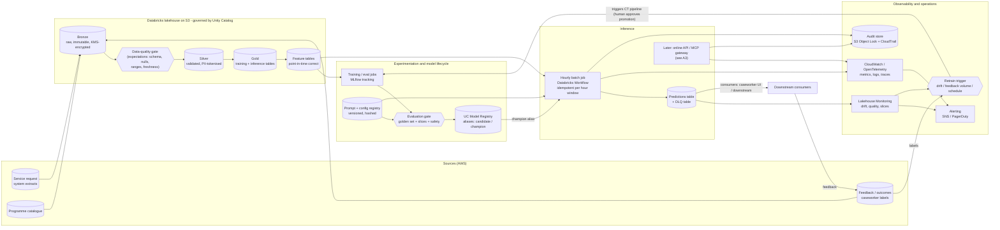
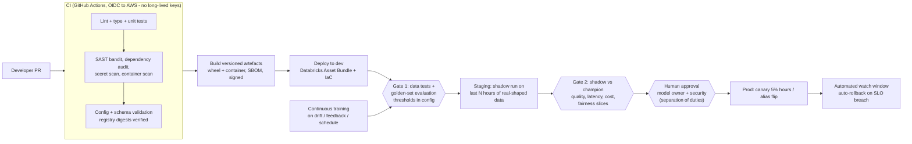
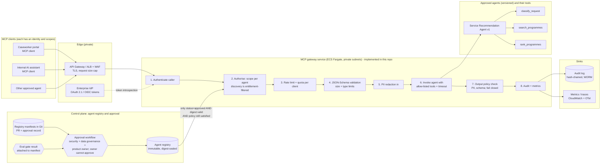
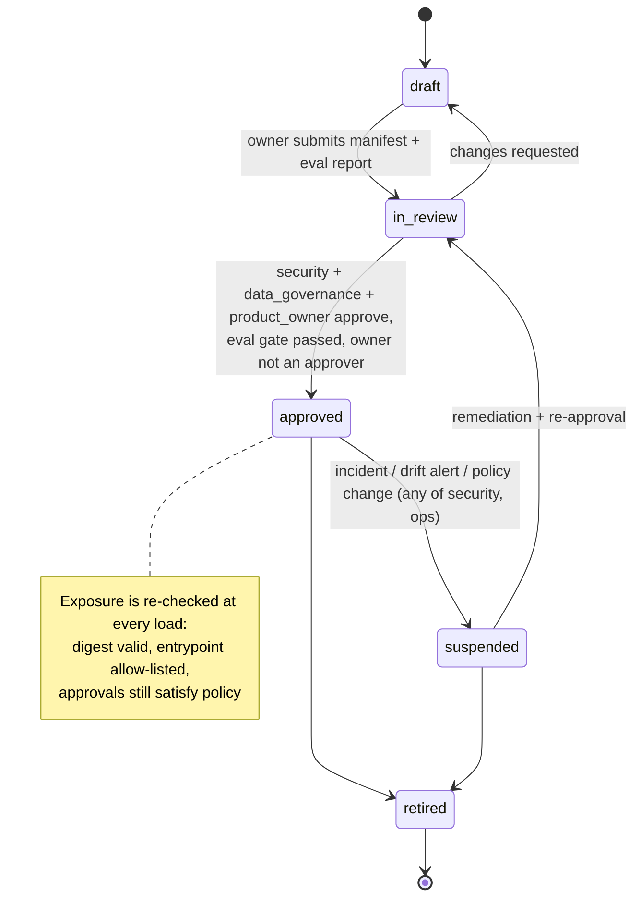
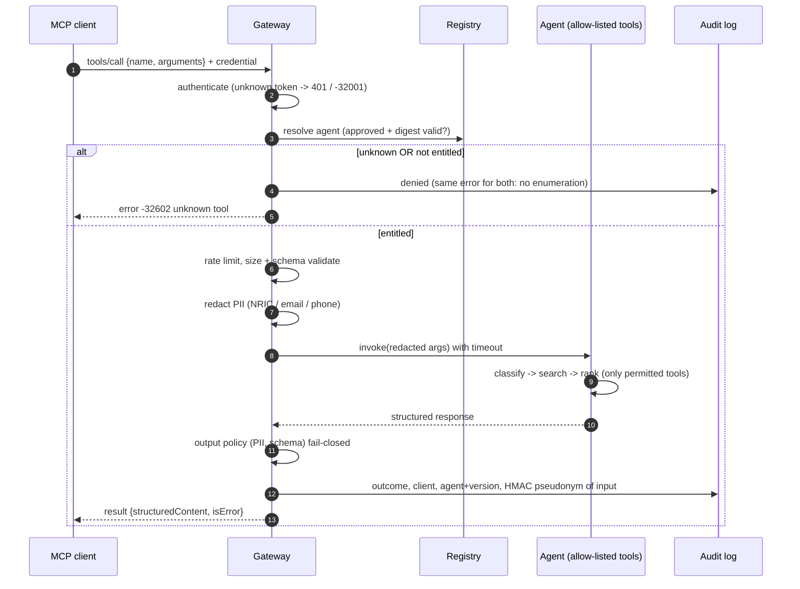
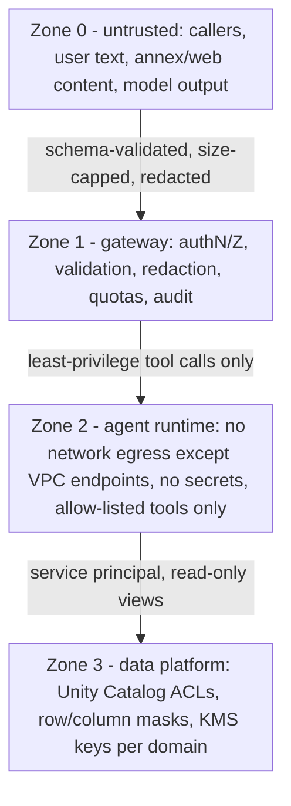

# Part 1 - Architecture Design (Deliverable A)

Diagrams are Mermaid (rendered natively by GitHub; PNG exports are in `img/`). Colour/shape key: **rectangles** = services/jobs,
**cylinders** = stores, **hexagons** = human/governance gates. "Control plane" = what decides *what may run*; "data plane" = what *moves data*.

## A1. End-to-end MLOps / AIOps platform (data and control flows)

**Control flows:** model promotion is an *alias move* in the registry,
gated by the evaluation gate and a human approver; the batch job reads the `champion` alias at start, so a rollback is another alias move
(no redeploy). Retraining is *triggered* automatically but *promoted* only through the same gate.

## A2. CI/CD/CT pipeline and release gates

## A3. Online serving and governed MCP exposure of agents

Agents **never** receive credentials, network access or tools beyond their manifest; the gateway is the only path to them, and it only
advertises agents the *caller* is entitled to (an unentitled caller cannot even enumerate them).

## A4. Agent approval workflow (state machine)

## A5. One `tools/call` (sequence, with the failure exits)

## A6. Trust boundaries

