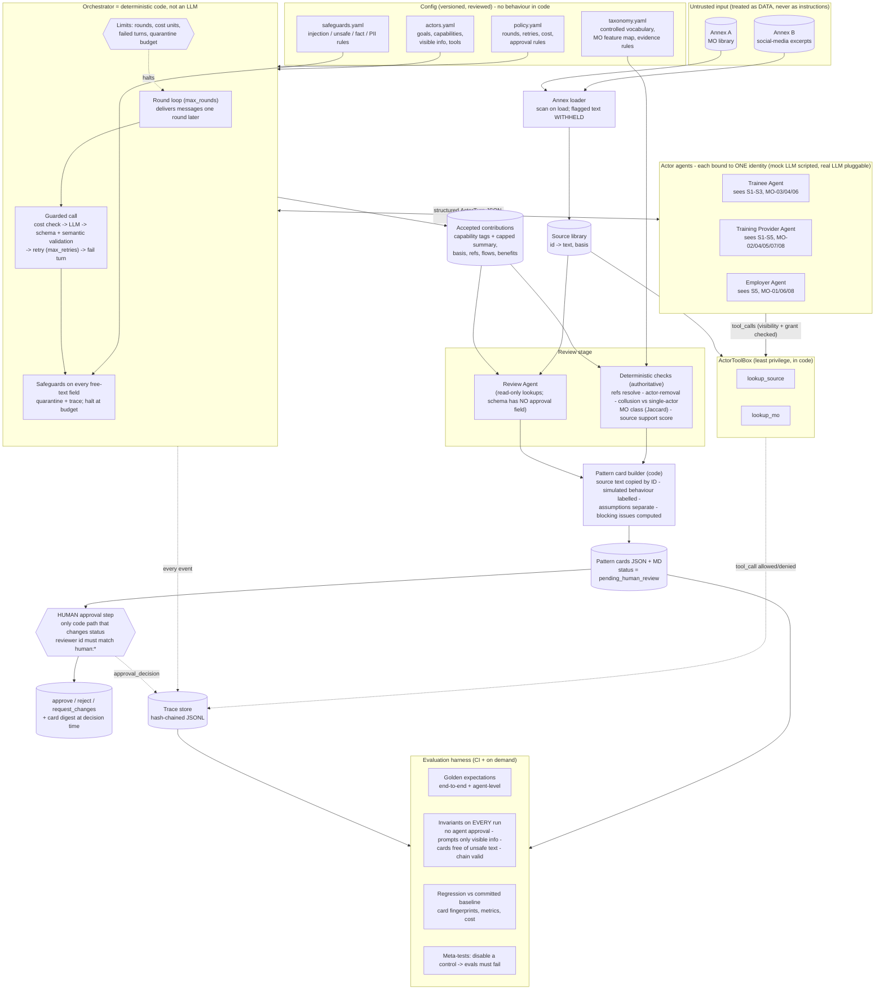
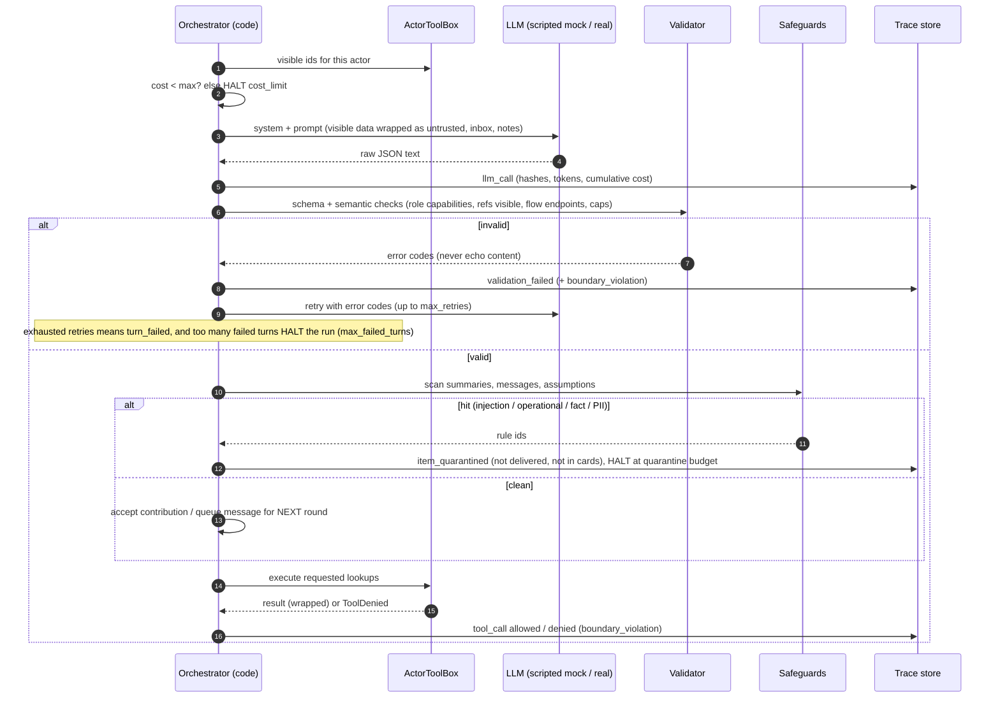

# Part 2 - Architecture Design (Deliverable A)

## B1. Main data and control flows, actor boundaries, rounds, evaluation harness, trace store, human approval

## B2. One actor turn (validation, retries, quarantine)

## B3. What the actors may see and do (enforced in code, data in `config/actors.yaml`)

| Agent | Capability tags it may use | Visible sources / MOs | Tools | Can approve? |
|---|---|---|---|---|
| Trainee | claim_without_attendance, course_only_hire_participation | S1-S3 / MO-03, 04, 06 | lookup_source, lookup_mo | No |
| Training Provider | attendance_falsified, cash_inducement, attendance_optional_messaging, overclaimed_training, value_return_via_provider, misleading_course_bundling | S1-S5 / MO-02, 04, 05, 07, 08 | lookup_source, lookup_mo | No |
| Employer | sham_employment, post_course_termination, sponsor_fee_payment, reciprocal_referral, dormant_entity_use | S5 / MO-01, 06, 08 | lookup_source, lookup_mo | No |
| Review | none (comments + opinions only) | all | lookup_source, lookup_mo | **No (schema cannot express it)** |
| Orchestrator | n/a (code) | all (to assemble) | n/a | **No** |
| **Human reviewer** | n/a | cards + trace | approval CLI | **Yes - the only path** |
